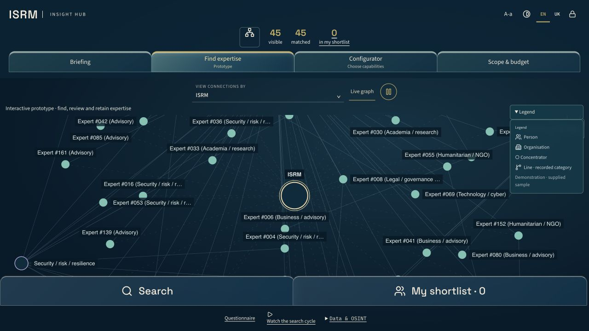
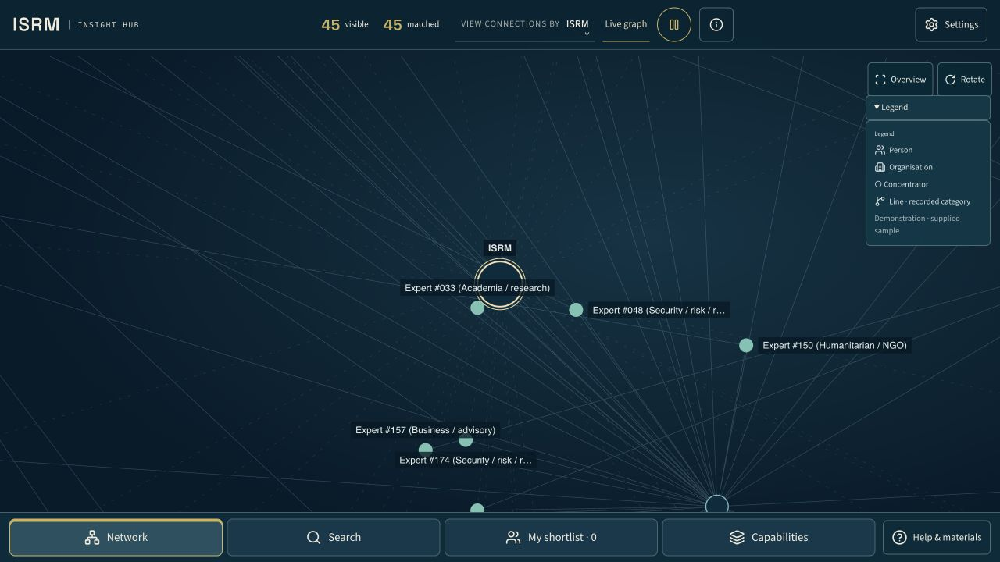
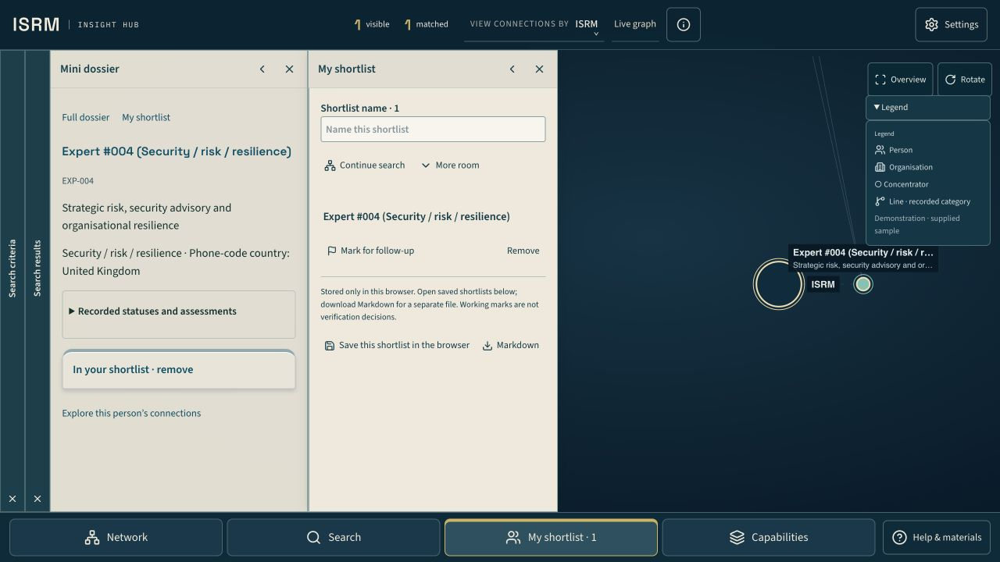
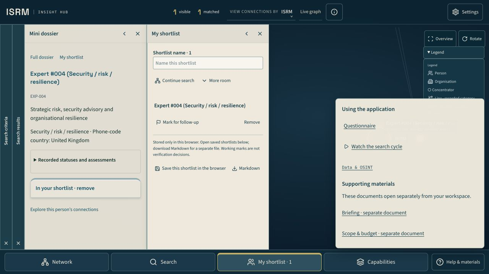
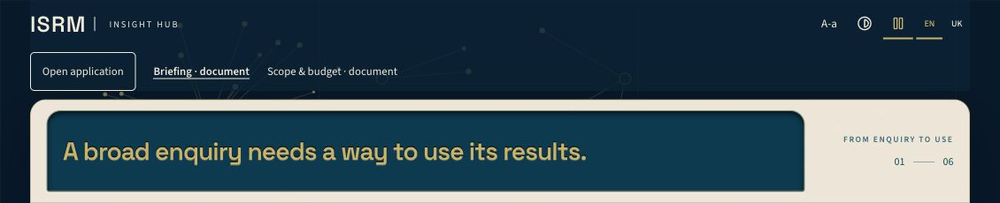
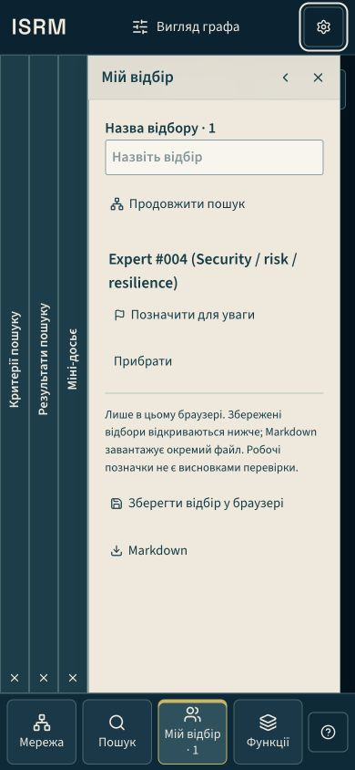

# ISRM: застосунок як основний продукт

**Історична контрольна точка.** Після наступних прямих уточнень 3 листопада реалізовано [новий локальний робочий простір](../workspace-revision-2026-11-03/README.md). Він замінює опис видимої пари панелей однією розгорнутою панеллю та закриває попередні відкриті частини вступу, спільного огляду, збережених пошуків і туторіалів. У новій навігації немає переходів до документів; старі кадри й статуси нижче стосуються зафіксованої тоді версії. Повний аудит конфігуратора й scope залишається відкритим.

Розпочато 2 листопада, уточнено й перевірено локально 3 листопада 2026 року. Цей розділ відповідає на пряме уточнення Алекса про відокремлення застосунку від презентації та комерційної пропозиції. Він зберігає погоджену механіку прототипу й пояснює, які нові рішення вже реалізовані, а які подані для змістового перегляду. Публічний сайт не оновлено.

## Висновок

Так, новий ракурс робить предмет зрозумілішим. Користувач отримує робочий застосунок, у якому можна виконати завдання; замовник окремо отримує пояснення цінності та умови придбання. Попередня послідовність «брифінг → пошук → конфігуратор → бюджет» змішувала щоденну роботу, демонстрацію та продаж. Це видно на наданих знімках і в локальному проходженні до зміни навігації. Усунення цього змішування є обґрунтованим рішенням структури. Його вплив на розуміння й попит ще потребує спостережень за користувачами.

Рекомендована модель вибору: **функція є предметом конфігурування; workflow є композицією функцій для конкретного результату, з ролями та правилами.** Попередньо зібрані композиції допомагають почати. Вони не повинні ставати обов’язковими пакетами, через які треба пройти, щоб обрати потрібну функцію. Сервісна послуга додатково потребує відповідального виконавця та погоджених умов виконання.

Образ суверенної системи й ширше організаційне застосування мають сенс як напрям розвитку. Наявний інтерфейс не доводить контроль над розміщенням даних, доступом, переносимістю або операційною відповідальністю. Приріст платних членств, рефералів і клієнтських звернень залишається гіпотезою пілоту.

## Межі джерел і рішення поточної сесії

Пряма вимога й повний текст нового ракурсу збережені в [джерелі користувача](../../project/sources/app-first-framing-user-2026-11-02.txt). [Доданий сторонній аудит](../../project/sources/orchestrator-audit-claims-2026-11-02.txt) розглянуто як набір тверджень для перевірки. Зміст цього вкладення не є дозволом запускати AI-дослідження людей, передавати дані, змінювати кошторис або оголошувати готовність.

Вимоги до смуг занесено до [REGISTRY](../../project/REGISTRY.csv) як `ISRM-REQ-TOP-ROW` і `ISRM-REQ-BOTTOM-ROW`. Їхні паспорти перевірено незалежно за QA-2. Пристосування до вузького екрана через меню є рішенням реалізації. Переліки й панелі продовжують підпорядковуватись `ISRM-REQ-LISTS` і `ISRM-REQ-PANELS`.

Локальний код змінюється в ізольованій копії `/Users/alexzvo/Documents/ChatGPT/isrm/work/isrm-prototype-panels`. Погодження попереднього прототипу та дозвіл на його локальну реалізацію збережені в [попередньому порядку роботи](../deep-audit-2026-10-31/IMPLEMENTATION-ORDER.md). Нова структура першого входу, зміст презентації та наступна модель конфігуратора нижче є рекомендаціями для приймання за FLOW-3. Повний аудит конфігуратора й комерційних розрахунків не підмінено цим розділом.

## Що показали екрани

### Крок 1. Вхід до зміни — проблема підтверджена

Бренд і налаштування, показники, вкладки матеріалів і керування графом займали окремі рівні зверху. Внизу робочі кнопки й допоміжні дії також стояли окремо. Проблема не зводилась до обмеження прокрутки панелей: навігація забирала простір і водночас задавала хибну модель послідовних документів. Джерело: поточне проходження та [наданий верхній](screens/01-user-top-strip.png) і [нижній](screens/02-user-bottom-strip.png) фрагменти.

### Крок 2. Робоча мережа — смуги ущільнено

Угорі залишені бренд, показники поточного вигляду, категорія зв’язків, керування рухом, пояснення вигляду й налаштування. Унизу — мережа, пошук, мій відбір, функції та допомога з матеріалами. Документи прибрано з головних вкладок застосунку. Кореневий маршрут відкриває застосунок; брифінг доступний за власним маршрутом. Це вже виконано локально.

Граф залишається робочою поверхнею. Цей знімок не доводить наявності реальних персональних знайомств, придатності до консультації або згоди на контакт. Ребра поточної моделі переважно відображають записані категорії. Загальний огляд вибірки зі спільними зрізами для брифінгу й першого входу залишається окремою незавершеною частиною.

### Крок 3. Пошук → досьє → мій відбір — контекст зберігається

Пошуковий критерій змінює граф і перелік результатів. Вибір результату відкриває міні-досьє. Додавання до відбору залишає поруч досьє й свідомо відібраний список, а попередні панелі доступні через іменовані корінці. У поточному проходженні перевірено повернення з розділу функцій до того самого досьє, критерію й складу відбору. Досьє показує наявний дозволений зміст; прапорець джерельного підтвердження не замінює рішення професійного рецензента.

Це демонстраційна робота з локальною чернеткою браузера. Вона не стала спільним проєктним сховищем, передаванням завдання або виконаним знайомством. Іменований відбір та експорт не є збереженим пошуком; відновлення семантичного знімка ще не реалізовано.

### Крок 4. Навчання та документи — доступні окремо

Опитувальник, приклад робочого циклу та пояснення даних доступні в допомозі. Брифінг і обсяг робіт позначені як окремі документи й відкриваються в іншій вкладці. Користувач може читати їх без заміни поточного робочого екрана. Автоматичного надсилання відбору або запиту цей перехід не виконує.

У заголовках брифінгу й обсягу робіт також прибрано вкладки та кільцевий лічильник етапів застосунку. Залишені посилання на окремі документи й явний перехід «Відкрити застосунок». Зміст слайдів і комерційні розрахунки цим не змінено. Перехід з брифінгу до обсягу робіт і повернення до застосунку перевірені.

### Крок 5. Вузький екран і налаштування — перевірено з обмеженнями

На вузькому екрані параметри графа відкриваються в іменованому меню. Назви робочих розділів залишені в нижній смузі. Перевірено українську локалізацію, збільшений текст, перемикання контрасту, закриття меню через Escape та відповідність ширини документа ширині екрана. Іконки налаштувань і допомоги мають доступні текстові назви; стан вибору позначено також обводкою й семантичним станом.

Під час перевірки виправлено слабкий контраст кнопок доступності в світлому меню. Це перевірка конкретних станів, а не висновок про повну відповідність стандарту доступності. Проходження зі скринридером, усі комбінації браузерного масштабування та повний аудит графа з клавіатури сюди не входять.

## Перевірка всіх нових тез перед зміною наступних поверхонь — FLOW-4

| Пункт джерела | Що підсилює ідею | Рішення та межа |
|---|---|---|
| 0. Застосунок — головне | Дає один зрозумілий предмет придбання й використання. | Локальна оболонка відокремлена. Готовність до операційного використання має визначатися приймальними критеріями, без відсотків із чужого аудиту. |
| 1. Початок з онбордингу | Пояснення вибірки й першої дії допомагає самостійному входу. | Рекомендовано пропускний вступ у контексті задачі. Новий повний онбординг ще не побудовано. |
| 2. Пошук — один із входів | Розрізняє пошук, роботу з відбором і налаштування функцій. | Зараз граф відкриває застосунок. Для повернення потрібен останній доступний робочий стан; універсальний портал усіх функцій поки не обґрунтований. |
| 3. Суміжні продукти й інтеграції | Допомагає запозичити звичні способи роботи та уникнути зайвого дублювання. | Нижче — дослідження офіційної документації. Реальну інтеграцію й передачу даних не перевірено. |
| 4–5. Функції утворюють workflow | Підтримує повторне використання й комбінацію функцій. | Окрема функція може бути входом у процес або його кроком. Для workflow потрібні мета, порядок, власник, правила й результат. Не створювати окрему повну програму навколо кожної кнопки. |
| 6. Конфігуратор залишається в застосунку | З’єднує початковий вибір із подальшою адаптацією. | Відділити доступне налаштування від запиту на майбутню розробку. Поточний вибір функцій не активує сервіси. |
| 7. Склад функцій і параметри організації | Дає придатний до обговорення результат конфігурування. | Зберігати склад, залежності, сценарій, аудиторії, доступ, системи та унікальні вимоги. Остаточна ціна виводиться після перевірки обсягу, без перенесення старих сум на нові композиції. |
| 8. Відбір завершується діями | Пояснює користь отриманого списку й мережі. | У демонстрації показувати очікуваний результат дії та її стан. Запит рекомендації, контакт і дослідження не називати виконаними без фактичного процесу. |
| 9. Презентація / one-pager окремо | Дозволяє мати матеріали для різних організацій і ролей. | У застосунку залишити доступ через матеріали; персоналізацію перенести в документи та профіль організації. |
| 10. Пропозиція окремо, користь без AI | Робить придбання незалежним від ще не підключеного дослідницького інструмента. | Пропонувати конкретний доступний цикл і необхідні доробки. AI — окреме підключення з власними межами. Комерційні умови ще потребують окремого аудиту. |
| 11. Звичайні місця для звичайних розділів | Зменшує потребу в поясненні керування. | Уже є робоча навігація, налаштування й допомога. Обліковий запис, ролі, організаційні політики й спільне сховище потребують реальної моделі, а не декоративних сторінок. |
| 12. Знімки як ідентифікатори | Допомагає впізнати список, карту чи композицію функцій. | Знімок є обкладинкою. Ідентичність задають стабільний ідентифікатор і версія семантичного стану. Експорт має перевіряти дозволи. Реалізація знімків ще відкрита. |

## Що можна запозичити в суміжних продуктів

Це дослідження офіційних сторінок функцій і довідки, прочитаних для цього розділу. Вхід у платні облікові записи та фактичний онбординг конкурентів не проходили. Нижче немає рейтингу продуктів, порівняння цін або твердження про готову інтеграцію.

| Первинне джерело | Спостережувана модель | Висновок для ISRM |
|---|---|---|
| [Affinity — Relationship Intelligence](https://www.affinity.co/product/relationship-intelligence) | Показує мережевий контекст і шляхи теплого знайомства поряд із роботою над відносинами. | Після відбору потрібен зрозумілий наступний крок і пояснення підстави зв’язку. Дані про контакт не підтверджують експертизу або згоду. |
| [Kumu — Views](https://docs.kumu.io/guides/views) | Відділяє карту з елементами та зв’язками від вигляду з фільтрами й оформленням. | Одна мережа може мати різні іменовані робочі вигляди. Знімок не повинен заміняти стан або породжувати нову незалежну базу. |
| [Hivebrite — Mentoring](https://hivebrite.io/features/mentoring/) | Поєднує каталог, добір, доступність учасників і процес програми. | Доречний сценарій починається з ролі та потреби учасника й продовжується після добору. Підтримка мотивації та участі є операційною роботою. |
| [Airtable — Interface Designer](https://support.airtable.com/articles/8078126534-getting-started-with-airtable-interface-designer) | Відділяє побудову інтерфейсу від виконання повторюваних задач кінцевим користувачем. | Налаштування можливостей має власний режим і відповідні права. Щоденна робота користувача не повинна вимагати розуміння конструктора. |

Мій висновок із цих джерел: доцільно поєднати робочий контекст, карту й перелік, наступну дію та окремий режим налаштування. Це інтерпретація для ISRM, а не доказ потреби кожної організації в однаковій конфігурації. Для кожного можливого шлюзу даних ще потрібні дозволені поля, напрям обміну, власник джерела, частота оновлення, права й фактичний інтеграційний контракт.

## Який перший екран рекомендується

| Варіант | Коли корисний | Рішення зараз |
|---|---|---|
| Граф із коротким вступом і вибором задачі | Коли треба зрозуміти доступну експертизу й одразу почати. | Рекомендований для поточної демонстрації. Граф залишається основою; доступний перелік має бути рівноцінним способом роботи. |
| Окремий стартовий екран задач і останніх робіт | Коли користувач має різні регулярні процеси й кілька робочих просторів. | Можливий після появи фактичних робіт і повторних відвідувань. Зараз більшість таких блоків була б порожньою. |
| Каталог усіх функцій або workflow | Коли адміністратор проектує конфігурацію. | Доречний у розділі функцій. Для нового звичайного користувача створює додаткову задачу вибору до початку роботи. |

Перший вхід має пояснити, що доступно в цій вибірці, чому частина даних закрита, чим записаний факт відрізняється від професійного судження й що відбудеться після вибору. Потім користувач обирає задачу. Повторний вхід повертає доступний збережений стан. Якщо доступ змінився, перед відновленням повторно обчислюються дозволені поля й склад записів.

Пропонована мікрокопія для вступу, ще не внесена як новий онбординг:

| Елемент | English | Українська |
|---|---|---|
| Заголовок | Start with the recorded expertise | Почніть з огляду наявної експертизи |
| Пояснення | Explore the supplied sample, then choose who needs a closer review. Recorded connections and source labels do not establish an endorsement or willingness to participate. | Перегляньте передану вибірку, а потім оберіть, чиє досьє потрібно розглянути. Записані зв’язки й позначки джерел не встановлюють рекомендацію або готовність до участі. |
| Перша дія | Find expertise | Знайти експертизу |
| Інша робоча задача | Review my shortlist | Переглянути мій відбір |
| Налаштування | Explore capabilities | Розглянути функції |
| Вихід зі вступу | Continue without the guide | Продовжити без підказок |

Критерій приймання: людина може пояснити межі вибірки, відкрити потрібний перелік і продовжити роботу без перегляду брифінгу. Навчання має бути доступне повторно з допомоги й не очищати власний робочий стан.

## Функції, workflow і конфігуратор

Функція виконує визначену дію над об’єктом: знайти запис, переглянути досьє, зберегти відбір, запитати рецензію. Workflow пов’язує такі дії для мети, наприклад підготувати обґрунтований добір і погоджене знайомство. Сервісна послуга включає людське виконання та відповідальність. Об’єднання цих понять під одним словом створює очікування, ніби обрання пункту вже забезпечує результат.

У графі композиції функції мають бути окремими вузлами, а залежності — підписаними зв’язками. Workflow можна показати як іменований маршрут або збережений набір з порядком виконання. Персони й цільові аудиторії можуть бути контекстом застосування. Ребро «потрібно для» між функціями відрізняється від «зацікавлений у» щодо людини; друге потребує окремого джерела.

Конфігуратор доцільно розділити за станом предмета, із видимими підписами: доступно в демонстрації; потребує підключення; запит на розробку. Для активної інсталяції додається стан налаштовано або вимкнено, але лише коли існує виконувана конфігурація. Один набір обраних функцій має одночасно керувати чекбоксами, графом, залежностями й результатом. Зміна композиції не повинна непомітно повертати виключені пункти через інший пакет.

Результат поточного конфігурування — погоджувана специфікація потреби. Вона містить обрані функції та їхні стани, сценарії й очікувані результати, ролі та відповідальних, користувачів і аудиторії, географію застосування, поточні системи, потрібні інтеграції, правила доступу й перенесення даних, унікальні вимоги та невирішені залежності. Значення про людей і системи вводяться з джерела або явно залишаються невідомими. Бюджет не перераховується зі старих пакетів автоматично.

**Виявлена межа поточного коду:** `serviceCovers` у `src/lib/network-model.ts` ілюстративно призначає зв’язки сервісів за хешем коду профілю. Він не читає інтерес, згоду чи використання сервісу. Отже, така картинка не може бути результатом вивчення попиту. До майбутнього конфігуратора попиту повинні потрапляти явні рішення й джерела, а не ці ілюстративні призначення. У цій сесії алгоритм не переписувався, ці дані не стали підтвердженими потребами.

## Чим має завершуватись пошук

Після відбору корисно запропонувати дії в контексті конкретного списку. «Запитати рекомендацію» створює запит із підставою та відповідальним; «Розширити дослідження» визначає питання, дозволені джерела й очікуваний результат; «Погодити знайомство» фіксує, кого, навіщо й через кого планують залучити. Далі відображаються фактичні стани: підготовлено, передано, прийнято, виконано або відхилено. Назва дії має відповідати реальній події.

Поки процес не підключений, дія відкриває чесний опис вимоги або локальну чернетку з чітким повідомленням, що її не надіслано. Кнопка не повинна створювати демонстраційний запис про згоду, рецензію або контакт, якого не було. Корисність без AI вже може складатися з пошуку, огляду, свідомого відбору, робочих нотаток, дозволеного експорту та передачі координатору за погодженим процесом. Фактичну передачу ще потрібно реалізувати й перевірити.

Карта «моїх можливостей» має розрізняти записаний тематичний збіг, підтверджену взаємодію, можливий шлях звернення та дозволене знайомство. Поточний спільний сектор або кейс не доводить, що люди знають одна одну. Джерело, дата й відповідальний додаються до самого відношення.

## Знімки графа як обкладинки й стан

Візуальний знімок добре працює разом із назвою списку, карти або композиції. Відновлення потребує окремого семантичного стану: стабільного ідентифікатора, версії джерела, критеріїв, кодів доступних записів, вибраних функцій і дозволених налаштувань вигляду. Доступ визначається заново при відкритті.

Не слід вважати зображення унікальним ідентифікатором або доказом незмінності: різні стани можуть виглядати однаково, а той самий стан — мати інше розташування вузлів. Псевдоніми та структура теж можуть розкривати інформацію, тому потрібні правила експорту й відтворення. Застарілий знімок після обмеження доступу не повинен обходити це обмеження.

## Як змінюється презентація

Причинну лінію Алекса варто зберегти повністю: великий дослідницький запит створює операційне питання використання, актуалізації й відповідального розкриття інформації. Цифрові інструменти допомагають опрацюванню; консультанти ISRM дають професійне судження з відповідальністю. Погоджені дії створюють можливість корисної взаємодії. Участь членів, мотивація, власники процесу, стандарти й політики дозволяють перевіряти ширше організаційне застосування. Саме поява AI не забезпечує цей перехід.

Для окремого брифінгу рекомендована така послідовність. Вона замінює роль чотирьох розділів застосунку як обов’язкового сюжету продажу; попередні формулювання з [редакції брифінгу](../deep-audit-2026-10-31/BRIEFING-REVISION.md) залишаються джерелом, а не зникають.

| Частина | Запитання клієнта | Що показати | Чого не стверджувати |
|---|---|---|---|
| Вихідний запит | Як використати результат дослідження? | Різницю між масивом записів і обґрунтованою наступною дією. | Вигадану економію або нібито вже оброблену повну аудиторію. |
| Практична робота | Як я з цим працюватиму? | Той самий огляд доступної вибірки, що й у застосунку, та наскрізний цикл до відбору. | Що демонстрація охоплює всю мережу або всі країни роботи. |
| Професійне судження | Хто відповідає за висновок і актуальність? | Джерело, дату, зміст перевірки, рецензента й межі доступу, коли ці поля наявні. | Що завершення AI-задачі означає верифікацію людини. |
| Участь і ширше застосування | Чому членам брати участь і які практики це підтримує? | Корисні запити, правила залучення, роботу координатора й альтернативні композиції функцій. | Автоматичний приріст членств, продажів чи рефералів. |
| Контроль | Як зберігаються чутливість і керованість? | Вимоги до розміщення, доступу, переносимості, згоди, відповідальних і процесу оновлення. | Доведений суверенітет або юридичну достатність лише через гостьове приховування. |
| Рішення зараз | Що саме погоджуємо? | Доступний сценарій, доробки до операційного використання, межі пілоту й окрему специфікацію потреб. | Обов’язкове підключення AI для користі базового застосунку або готовність усіх запланованих сервісів. |

Запитання про застарівання, конверсію та розкриття корисні як перевірка змісту презентації. Клієнту краще дати спостережуваний приклад і зрозумілу межу, щоб він сам оцінив користь. Враження «створено консультантами для консультантів» має виникати з точності робочого сценарію та відповідальності за результат.

Пропонований вступ для окремого документа:

**Українська.** Ви звернулися із завданням дослідити великий масив контактів. Наступне практичне питання — як підтримувати інформацію актуальною та перетворювати її на обґрунтований добір і погоджену взаємодію. Ми пропонуємо робочий застосунок для цього процесу: цифрові інструменти допомагають опрацюванню, а професійне судження й відповідальність залишаються за людьми. Пілот має перевірити корисність цього підходу для ISRM і визначити, які додаткові функції підтримають участь членів та роботу асоціації.

**English.** Your enquiry asks us to research a large contact base. The next practical question is how to keep that information current and turn it into a reasoned selection and an agreed interaction. We propose a working application for that process: digital tools support information handling, while people retain professional judgement and responsibility. A pilot should test its usefulness for ISRM and establish which additional capabilities would support member participation and the association’s work.

Це кандидат змісту. У цій сесії весь слайдер не переписувався під нову структуру, one-pager не створювався, комерційну пропозицію не змінено.

## Що із доданого аудиту не підтвердилось

Сторонній текст посилається на `iso-orchestrator`, `discoverProjectSessions`, `sessionGraph` і `batch-state.tsv` як на готову основу застосунку. Пошук у перевірених runtime-шляхах локальної реалізації й названого опублікованого коміту не знайшов цих компонентів або їхнього зв’язку з досьє ISRM. Реальний перевірений шлях формує дозволену проєкцію наявних JSON-записів і фільтрує її. Код не підтверджує заявлену готовність AI-досліджень. Межі пошуку й незалежна перевірка наведені в [доказі](../../project/evidence/app-first-qa-2026-11-03.json).

Граф сесій агентів, навіть якщо він існує в іншому інструменті, описує виконання технічних задач. Він не встановлює експертизу, професійні зв’язки, згоду або результати взаємодії людей. Журнал завершених задач не є автоматично незмінним доменним журналом рекомендацій. До презентації не перенесено відсотки готовності, повторного використання, години, суми або інші неперевірені оцінки цього аудиту. Окремий інструмент оркестрації може бути корисним лише після перевірки його фактичного контракту з доменною моделлю.

## Приймання й залишок роботи

Локально виконано ущільнення смуг, навігацію застосунку, окреме розміщення матеріалів, вхід через кореневу адресу та збереження контексту при переході до функцій. Під час перевірки прибрано перенесення відкритого досьє як випадкового ілюстративного профілю в режим функцій; стан прототипу зберігається для повернення.

Виконано відповідні тести робочих станів, перевірку стилю змінених компонентів і production-збірку. Загальний TypeScript і загальний lint мають попередні помилки поза цим пакетом; вони не оголошуються успішними. Порівняння з попереднім набором діагностик і логи наведені в [технічній перевірці](../../project/evidence/app-first-validation-2026-11-03.json). Знімки підтверджують перевірені стани, без висновку про готовність до промислового використання.

Наступний предмет змістового приймання — модель входу за задачею та правило «функції обираємо, workflow складаємо». Після цього можна реалізувати вступ, спільний огляд вибірки й семантичне збереження пошуків та карт у тому самому локальному пакеті. Повна перебудова конфігуратора, нові інтеграції, серверне збереження, операційні запити й комерційні розрахунки залишаються окремою роботою.

### Контроль відповідності протоколу

- Пряме уточнення збережено окремо від стороннього аудиту; OVERLAY, ENTRY й REGISTRY звірені.
- Попередні версії збережено до заміни; джерела, знімки й записи сесії перевіряються контрольними сумами.
- Кількісні комерційні твердження не додано; прямі вимоги до смуг мають паспорти й незалежне приймання QA-2.
- Всі нові тези маршрутизовані до поверхонь; виконане відділене від рекомендованого й непідключеного.
- Вибір не означає згоду, рекомендацію, контакт, дослідження або активацію сервісу.
- Кнопки, мова, колір і стани перевірені в зазначених межах; повний аудит доступності не заявляється.
- Оригінальні кодові копії, публічний сайт і історія Git не переписувалися; push та deployment не виконувалися.
