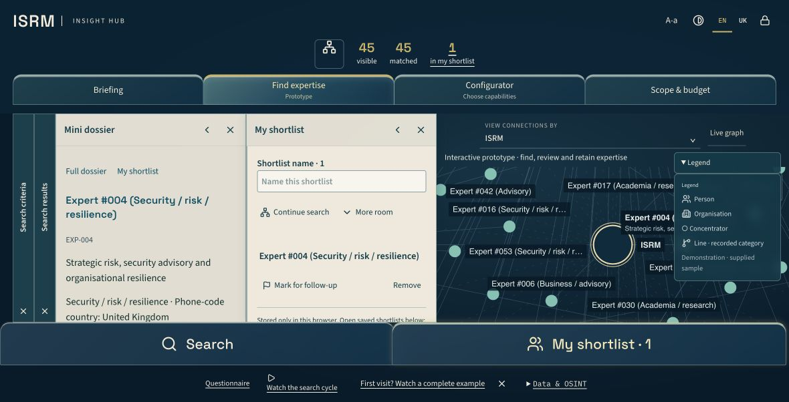
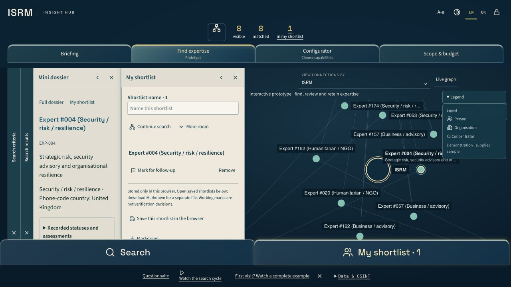
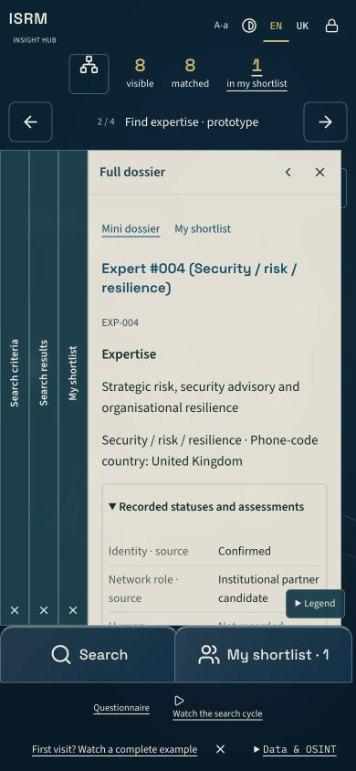
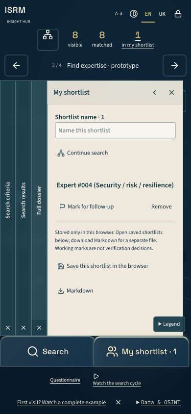
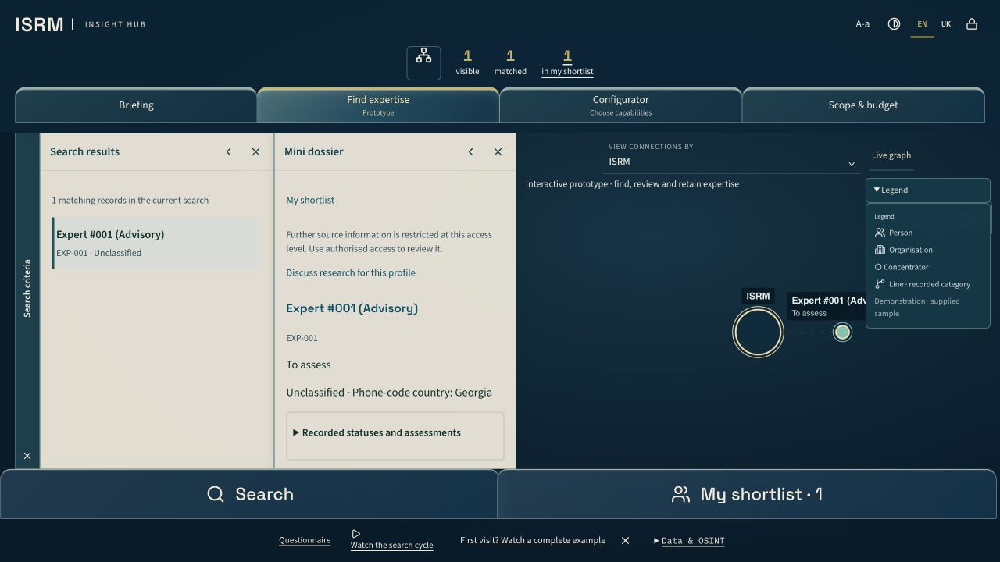

# ISRM: локальна реалізація робочого циклу та редакція брифінгу

Перший пакет розпочато 1 листопада й завершено для локального перегляду 2 листопада 2026 року. Це результат погодженого переходу від аудиту до реалізації. Аудит конфігуратора та реалізація всього подальшого задуму цим документом не оголошуються завершеними.

[Відкрити локальний прототип](http://127.0.0.1:8771/?view=map) · [Локальна презентація](http://127.0.0.1:8771/proposal) · [Тексти презентації та модель сервісного вибору](BRIEFING-REVISION.md) · [Погоджений аудит](PROTOTYPE.md)

## Що працює в цьому пакеті

Результати пошуку стали окремою робочою поверхнею. Їхній склад береться з того самого відфільтрованого набору, що передається графу. Профіль із результатів відкриває пару «результати + міні-досьє», а критерії залишаються в іменованому корінці. Додавання з міні- або повного опису стискає досьє та відкриває поряд мій відбір. Повторне розгортання досьє зберігає саме цей відбір сусідом. Обмеження видимої пари відповідає `ISRM-REQ-PANELS`; різні призначення переліків — `ISRM-REQ-LISTS`.

Закриття X прибирає поверхню, не очищаючи критерії чи обрані коди. Схлопування залишає корінець; Show graph зберігає доступний контекст. Прихований відбір відкривається відразу, без повторного перемикання прапорця. Ширину можна змінювати перетягуванням або клавіатурою; Full dossier розширює панель, а зсув краю до сусіда схлопує її. Після зміни повного/короткого режиму досьє повертається до початку; позиція пошукового переліку зберігається окремо.

Dashboard стоїть перед навігацією розділів. Робочі аркуші обмежені верхньою та нижньою поверхнями; допоміжні дії й запрошення до навчального показу розміщені під нижніми кнопками. Легенда праворуч має доступну дію розгортання на вузькому екрані й відділяє записану категорію від особистої рекомендації. Окремий блок Through what might these profiles connect? прибрано з головного поля; явна дія дослідження зв’язків у досьє збережена. Це ще не нова модель засвідчених персональних взаємин.

Повний опис визначається доступним предметним змістом. Значення To assess, загальна назва категорії та маркер research pending не утворюють повного досьє. Якщо додатковий зміст закритий, гість отримує пояснення про рівень доступу. Нова ознака передає лише стан доступності, без значень закритих полів. Наявний зміст може розгортатися й при verified=false. У повному описі немає порожньої доказової секції заради напису «не надано»; робочі нотатки й відзнаки залишаються відділеними від вихідної перевірки.

У межах переходу до конфігурації сервісу й назад відновлюються критерії, черга, відкрите досьє та видима пара. Це перевірено для переходу до research capability. Повне повернення зі сторінки scope та оформлення адресованого сервісного запиту потребують наступного пакета; перехід за посиланням нічого не надсилає й не виконує дослідження.

## Перевірений шлях

| Крок | Результат | Практична межа |
|---|---|---|
| Пошук і результати. | Граф і перелік отримують узгоджений склад; відкривається правильний профіль. | Таксономія й нульові довідкові категорії не перебудовані цим пакетом. |
| Міні-/повне досьє. | Явна кнопка й ручна зміна ширини працюють; непідготовлений запис не відкриває порожню оболонку. | Закриті поля не перевірялися під вигаданим або розширеним доступом. |
| Відбір. | Додавання стискає опис і відкриває відбір; повернення з графа працює одразу. | Збереження залишається локальним у браузері. |
| Корінці й ширина. | Зміна ширини, Home на розділювачі, схлопування краєм і відновлення пройдені у браузері. | Розмір аркуша залежить від доступного місця; сусід може перейти в корінець. |
| Вузький екран. | Активний аркуш і корінці зберігають обидва робочі контексти; горизонтального переповнення сторінки в перевіреному режимі не виявлено. | Це не повний аудит доступності або всіх пристроїв. |
| Повернення з конфігуратора. | Відновлено той самий пошук і досьє; явного сервісного виконання немає. | Сам конфігуратор і його пакетна модель поки не перебудовані. |
| Презентація. | Тексти всіх наявних слайдів оновлені; приховані раніше примітки показуються. Фінальна схема веде до конфігуратора й розгляду обсягу. | Спільний початковий огляд і повна зміна навчальних схем ще попереду. |

[Повторна браузерна перевірка 2 листопада](../../project/evidence/local-browser-handoff-2026-11-02.json).

Кадри збережено й оглянуто під час цього проходження. Проміжні кадри зі старим розміщенням Dashboard або ще не виправленим визначенням змісту перенесено до робочого архіву; вони не є доказами кінцевої поведінки.

## Редакція презентації

Лінія стала явною: широкий запит → операційна задача опрацювання → цифрові інструменти й професійне судження ISRM → корисне застосування → участь, стандарти й організаційний розвиток → пілот і наступне рішення. Не заявляється, що консультанти вже погодили участь або ширший ефект уже отримано.

Рекомендація щодо вибору: сервіси та потрібні функції є предметом конфігурації; workflow пояснює їх поєднання під задачу. Повні EN/UK тексти, роль кожного слайда, необхідні зміни схем і межі поточної реалізації наведено в [редакції брифінгу](BRIEFING-REVISION.md). Це конкретний кандидат на змістове приймання. Наявна фінансова модель конфігуратора й scope не змінювалися.

## Технічна перевірка та незалежний перегляд

Цільові тести пройшли; lint усіх змінених і нових TypeScript-файлів пройшов; production build і git diff --check пройшли. Повний npm run lint завершується помилками в наявних файлах поза зміненим переліком. Загальний TypeScript check теж залишається незеленим через початкові проблеми; нових діагностик порівняно з зафіксованою базою не додалося. Пакет не названо повністю зеленим репозиторієм.

[Паспорти перевірок і контрольні суми коду](../../project/evidence/local-implementation-manifest-2026-11-02.json). [Цільові тести](../../project/evidence/local-implementation-checks-2026-11-02/implementation-tests-final.log). [Lint змінених файлів](../../project/evidence/local-implementation-checks-2026-11-02/changed-files-lint-final.log). [Збірка](../../project/evidence/local-implementation-checks-2026-11-02/implementation-build-final.log). [Повний lint](../../project/evidence/local-implementation-checks-2026-11-02/implementation-lint-final.log). [TypeScript](../../project/evidence/local-implementation-checks-2026-11-02/implementation-tsc-final.log). [Diff для перегляду](../../project/evidence/local-implementation-checks-2026-11-02/local-code-changes.diff.txt).

Незалежний агент за QA-2 перевірив гостьову проєкцію, доступність змісту, відсутність gate за verified та чесність опису невиконаної міграції конфігуратора. Знайдений крайовий випадок, коли наявні лише приховані контактні/організаційні поля, виправлено перевіркою їхньої наявності без передання значень. [Окремий висновок і межі](../../project/evidence/independent-review-local-implementation-2026-11-02.json).

Між проходженнями зникла тимчасова тека, на яку вказував старий node_modules. Пошкоджене посилання архівовано. Залежності встановлені в ізольовану копію з незміненого lockfile та окремим кешем, після чого перевірки повторено. Налаштування npm у домашній теці не змінювалися.

## Де код і що ще відкрите

Код збережено в `/Users/alexzvo/Documents/ChatGPT/isrm/work/isrm-prototype-panels`, гілка `codex/isrm-prototype-panels`, база `56d43f22085d7c248b19b4d087fde444fecdb541`. Ізольовану копію створено звичайним git worktree, оскільки інструмент керованих копій не прийняв вкладений sourceRoot. Зміни залишаються локальними; push, merge, очищення історії й deployment не виконувалися.

Наступний пакет погодженого задуму: збережений пошук і семантичні знімки графів обох переліків, спільний початковий огляд брифінгу й прототипу, розрізнення відновлення знімка й повторення запиту. Початковий граф досі не тотожний схемі вибірки в брифінгу. Нові засвідчені особисті рекомендації, спільні кейси та згода не створені; потрібні відповідні вихідні дані й процес. Модель сервісного вибору та її підсумок у scope залишаються предметом наступного аудиту. Це відкриті частини загального завдання, не завершені можливості цього пакета.

Відомий ризик контактного джерела в публічному Git-дереві залишається окремою задачею перед новим опублікуванням. Його не усунуто маскуванням інтерфейсу або поточним локальним пакетом. Тестовий відбір у локальному браузері є демонстраційною перевіркою, не рекомендацією клієнту; контактів, досліджень і повідомлень людям не надсилали.
